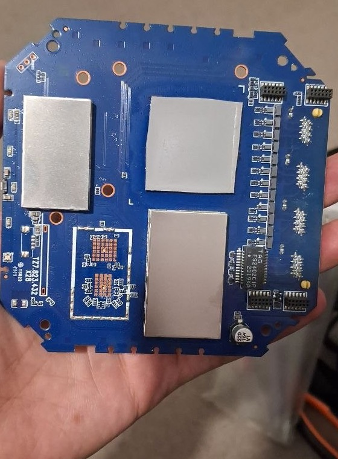
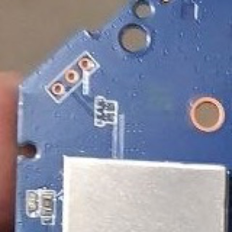

My ZLT X28 now boots an OpenWrt 23.05.5 userspace, brings up its 5G connection through netifd, and runs WireGuard and Passwall2. It still uses the vendor's Linux 4.19.205 kernel and proprietary modem stack. On a local benchmark, WireGuard reached 715 Mbit/s sending from the router, with CPU headroom left.

This walkthrough follows how the project developed: first getting inside the stock system through Telnet and SSH, then repairing LuCI, identifying the serial console, backing up the flash, reverse engineering the boot binaries, and building a native OpenWrt system. Along the way, it introduces the pieces that make an embedded Linux router work. This became one of the most satisfying systems engineering projects I have worked on: hardware, firmware and networking all meeting in one box.

The code and engineering record are in [zlt-x28-openwrt](https://github.com/mralinp/zlt-x28-openwrt). The firmware results below describe release `v0.37.0` as recorded on November 2, 2026; the UART wiring follows the repository’s later corrected pinout. It is a beta tested on **one unit, one SIM and one carrier**.

# 1. Why replace the firmware?

The X28 is a 5G CPE built around MediaTek's MT6890/T750 platform and Quectel's RG500L modem platform. It ships with a vendor-customized OpenWrt 19.07 system and a vendor web interface.

I wanted the hardware to behave like a normal OpenWrt router: configure interfaces in LuCI, keep settings in UCI, let netifd manage network lifecycles, and run VPN and proxy tools through the standard networking stack. I also wanted to keep the working modem and board-specific calibration.

There was useful prior work. [EngineerMazeed/ZLT-X28](https://github.com/EngineerMazeed/ZLT-X28) brought LuCI onto the stock firmware, and [gaglians/zlt-x28-openwrt2305](https://github.com/gaglians/zlt-x28-openwrt2305) explored a newer userspace on the vendor kernel. The [MT6890 recovery project](https://github.com/mt6890-cpe-recovery/mt6890-cpe-recovery) and [mtkclient](https://github.com/bkerler/mtkclient) provided essential recovery foundations.

My target was an integrated system where OpenWrt owns network policy and the vendor components provide the hardware backend. That distinction shaped almost every decision afterward.

# 2. Getting inside: Telnet, then SSH

The first phase happened on the original firmware. We began with a Telnet foothold on the unlocked test unit. Telnet gave us a shell inside the box, where we could inspect the running Linux system instead of relying on the vendor web interface.

Telnet carries its session without encryption. For continued work, we moved to **Dropbear**, the lightweight SSH server commonly used on embedded systems, with public-key authentication. In this stock-firmware phase it listened on the LAN address at port **2222**. Later, the native image moved SSH to the usual port **22**.

The preserved access scripts show how we bootstrapped that SSH service: an authenticated request to the vendor web backend used a command-injection path in its DMZ setting handler to execute a shell command. One script installed an already staged public key into Dropbear’s `authorized_keys`; another started Dropbear bound to the LAN address, with password authentication and forwarding disabled. Both attempted to restore the temporary DMZ setting afterward. That restoration was cleanup, not a general transaction or guaranteed rollback.

This was access to our own device. The public early narrative stops at the Telnet foothold, so it does not provide a complete Telnet-unlock recipe. The important transition for the project was from temporary access to repeatable, authenticated SSH access, and then making that service survive reboot.

Once inside, a few read-only commands established the baseline:

```sh
# Historical stock-firmware SSH endpoint; the native image uses port 22.
ssh -p 2222 root@192.168.70.1

uname -a
cat /etc/openwrt_release
cat /proc/cmdline
cat /proc/mtd
ps w
```

These answer different questions: which kernel is running, which OpenWrt base the vendor used, which slot Linux mounted, how flash is partitioned, and which processes actually own the network. On embedded devices, the configuration files alone often tell only part of that story.

The web UI also supplied useful evidence. Its JavaScript sends JSON requests with command IDs to `cgi-bin/http.cgi`. Mapping those calls exposed how settings reached the vendor backend; the [command map](https://github.com/mralinp/zlt-x28-openwrt/blob/main/docs/vendor-command-map.md) records that interface.

# 3. Repairing LuCI on the stock system

**LuCI is OpenWrt’s web interface.** Having it load does not mean the router underneath is managed by standard OpenWrt services.

The initial LuCI installation had a partly working theme, missing menus, pages that returned 404, and an Interfaces page that could not identify the protocols. We restored missing theme assets, views, menus and protocol definitions, while preserving existing files that were more complete than the replacement archive.

Some failures required tracing the request through several layers. The status overview needed an `rpcd` access-control rule to read its view directory. A small read-only RPC helper exposed protocol handlers so LuCI could name the interfaces. The vendor’s `mini_httpd` also treated `/cgi-bin/luci/` differently from `/cgi-bin/luci`; redirects needed to use the working form.

At this stage the two interfaces coexisted:

| Service | Stock-phase endpoint |
| --- | --- |
| Vendor web interface | Ports 80/443 |
| Separate LuCI instance | Port 4153, `/cgi-bin/luci` |
| Key-only SSH | Port 2222 |

A reboot supplied another lesson: files persisted, but manually started services disappeared. Startup entries brought Dropbear and the separate LuCI server back automatically.

The deeper limitation was ownership. **netifd**, OpenWrt’s network manager, was not running; the vendor stack controlled the live interfaces. The UCI network configuration described a different LAN from the one actually in use. Applying it could disconnect the router. The early Network pages were therefore inspection tools, not proof that LuCI could safely configure the whole system.

That is why the project grew beyond installing a web panel. We needed to move network ownership to OpenWrt. The [LuCI fix notes](https://github.com/mralinp/zlt-x28-openwrt/blob/main/docs/luci-fix-notes.md) preserve the early fixes and their limits.

# 4. Proving recovery before replacing the system

Before changing the root filesystem, I needed to know what was on the flash and how to put it back.

The project started with **hash-verified backups of all 51 NAND partitions**. A router backup includes much more than the operating system: boot components, modem firmware, calibration and device-specific data. Losing those can turn a recoverable software mistake into a much harder problem.

Then came the independent USB path through the MediaTek preloader and download agent. All 51 partitions were read over USB. The guarded tools also wrote and restored `rootfs_a` and `rootfs_sig_a`, establishing a recovery path for the targets the native image needed.

A read succeeding does not establish that every partition can be restored. For example, download-agent writes to `misc` were not acknowledged; the project uses the stock live NAND method for that metadata. That limit is documented rather than hidden behind a general claim that recovery works.

The write tools check their targets, preserve receipts, and compare the other slot and neighboring partitions before and after writes. A 1.8 V UART provides visibility when Linux and SSH are unavailable.

This was a substantial part of the project in its own right. The [recovery documentation](https://github.com/mralinp/zlt-x28-openwrt/blob/main/docs/RECOVERY.md) records the equipment, checks and limits. This post is not an installation recipe; flashing needs the full device-specific procedure.

## Finding and wiring the UART

SSH only becomes available after Linux and the network start. A UART serial console lets us see the earlier preloader and bootloader messages, including failures that never reach SSH.

<figure>
  <a href="/assets/images/posts/blog/zlt-x28/x28-board-back.jpg"></a>
  <figcaption>The back of the actual board. The three-hole footprint near the top-left corner is the serial-console connection. Click to enlarge.</figcaption>
</figure>

<figure>
  <a href="/assets/images/posts/blog/zlt-x28/x28-uart-candidate.jpg"></a>
  <figcaption>The UART footprint close up. Its repository filename still says “candidate”; the wiring was subsequently confirmed on the test unit.</figcaption>
</figure>

Following the orientation in these photos, the holes run **board RX, GND, board TX**, from the left/lower end of the diagonal footprint to its right/upper end:

| Board signal | Connection |
| --- | --- |
| RX | Adapter TX through a suitable level shifter; omit for passive capture |
| GND | Adapter and level-shifter ground |
| TX | Adapter RX through a suitable level shifter |

**The board uses 1.8 V logic. There is no VCC pin on this footprint.** Do not connect the adapter’s 3.3 V or 5 V power pins, or drive board RX directly from a 3.3 V transmitter. Use a suitable level shifter or a genuinely 1.8 V-capable adapter.

The tested unit decoded at **921600 baud, 8N1**. Another unit was reported at 115200, so the rate needs checking against the unit’s kernel command line or boot log. Early captures also exposed bad-ground and voltage-level problems. On macOS, opening a port separately with `stty` and then `cat` could reset the rate; configuring the same open descriptor avoided that trap.

For the first passive capture, adapter TX was disconnected. We could then observe the preloader, LK and Linux without sending anything to the board. A serial output stream is also distinct from an interactive login: the stock firmware’s getty was commented out, so seeing logs did not initially give us a UART shell.

The [recovery guide](https://github.com/mralinp/zlt-x28-openwrt/blob/main/docs/RECOVERY.md) is the source for the corrected pinout and electrical requirements; the [UART report](https://github.com/mralinp/zlt-x28-openwrt/blob/main/docs/research/uart-boot-log.md) preserves the earlier boot observations.

# 5. Understanding the boot path

The X28 has A/B firmware slots, but knowing that two slots exist does not explain when the device will switch between them.

The investigation combined partition dumps, live observations, UART logs and static analysis of the boot components. It covered slot metadata, boot counters, rootfs signature handling and the information passed from the bootloader to Linux. Each finding needed a clear boundary between what the bytes suggested and what a real boot confirmed.

The native root filesystem now runs on **slot A**, while **stock slot B remains untouched**. The image keeps the vendor boot components and kernel; booting this rootfs does not establish that an arbitrary replacement kernel will boot.

One particularly important detail was the boot-success logic. The preloader adds a try on each boot. The project's `x28-bootok` resets the counter after a good boot, following the relevant stock behavior. Slot A deliberately retains a zero success flag to preserve the preloader's fallback behavior. The stock success path also copies A over B, which would consume the stock fallback this project is preserving.

A seemingly harmless “mark boot successful” operation therefore required understanding its wider effects. The [boot-flow research](https://github.com/mralinp/zlt-x28-openwrt/blob/main/docs/BOOT-FLOW.md) keeps the evidence and its dated updates.

## Reverse engineering the boot binaries

The UART showed which checks ran. Understanding what those checks meant required examining the saved binaries themselves.

**LK**, or Little Kernel, is the bootloader stage that loads the kernel and prepares its boot information. We analyzed its original NAND dump using Capstone disassembly and later Ghidra. These tools turn machine instructions into assembly and approximate C-like pseudocode; neither recovers the vendor’s original source code.

Getting the processor mode and address mapping right mattered. This LK image has an ARM entry stub that switches into Thumb code. The Ghidra analysis mapped the raw image at `0x83fffe00`, accounting for its partition header. A plausible-looking decompilation with the wrong mapping would have been poor evidence, so the scripts first checked the input size, hash and mapped bytes.

The investigation followed a concrete sequence:

1. Find partition names, diagnostic strings and references to them in code.
2. Trace calls, return values and branches around certificate verification.
3. Follow a returned error into the assertion and panic path.
4. Extract certificate data and independently check what its signatures covered.
5. Compare those findings with the boot log, live device-tree properties and later native boots.

One result was precise: **a returned rootfs-certificate verification error leads to a panic/halt path**. It does not simply print a warning and immediately boot the other slot. That conclusion came from traced instructions, not from deliberately booting an invalid certificate.

Another result required separating two questions. The `rootfs_sig` partition contains a certificate chain whose signed data includes the stock SquashFS digest and size. We reconstructed the logical SquashFS from its UBI container and matched the digest. Independent RSA-PSS checks corroborated the signed message ranges. But verifying a certificate containing a digest is different from reading the current rootfs and comparing its bytes with that digest.

The static investigation found no visible normal-boot consumer performing that content comparison. That was initially a hypothesis with explicit gaps, including unexamined secure-world behavior. The later native boot provided the practical result: our changed rootfs ran with the original rootfs certificates and unchanged captured boot components. It established that particular combination works on this unit.

**It did not establish that an unsigned replacement kernel would boot.** LK’s boot-image path has separate policy, certificate, header and payload authentication checks. We mapped those paths in Ghidra as a separate investigation. A later two-branch patch preview stayed inside a local Ghidra database; it was not exported, flashed or executed on the device.

The preloader investigation also had an honest stopping point: relocation and table-driven references prevented us from fully recovering the invalid-slot-to-USB-handshake path in the initial analysis. A backup and a working USB session were not enough to claim every possible boot failure recoverable.

For the full evidence, see the [signed-content analysis](https://github.com/mralinp/zlt-x28-openwrt/blob/main/docs/research/rootfs-signed-content.md), [content-enforcement investigation](https://github.com/mralinp/zlt-x28-openwrt/blob/main/docs/research/content-enforcement.md), [LK authentication map](https://github.com/mralinp/zlt-x28-openwrt/blob/main/docs/research/lk-authentication-ghidra.md), and [local patch preview](https://github.com/mralinp/zlt-x28-openwrt/blob/main/docs/research/lk-boot-auth-preview.md).

# 6. A modern userspace on the vendor kernel

Replacing the kernel would also mean replacing or rebuilding the drivers that make this particular board and modem work. The practical first step was to keep Linux 4.19.205 and assemble a newer OpenWrt userspace around it.

The resulting system has three parts:

| Layer | What it provides |
| --- | --- |
| OpenWrt 23.05.5 userspace | LuCI, UCI, netifd, DHCP/DNS and standard packages |
| Vendor hardware support | The existing kernel, board modules, modem and Wi-Fi components |
| Project packages | Cellular integration, modem startup, Wi-Fi handling, LEDs, boot-counter handling and additional kernel modules |

Kernel capabilities constrain the userspace. The stock kernel lacks `nf_tables`, so this build uses **fw3 and iptables-legacy**. Official OpenWrt kernel modules cannot simply be installed onto a different vendor kernel, even when userspace packages work.

The build also respects the distribution boundary. Public CI assembles the open userspace and publishes its manifest and hashes. Local tooling combines that with proprietary components extracted from the owner's own backup. The public repository distributes build tools and original packages; it does not publish the vendor firmware as a ready-to-flash image.

The [build documentation](https://github.com/mralinp/zlt-x28-openwrt/blob/main/docs/BUILD.md) explains how those halves meet.

# 7. Making 5G a normal OpenWrt interface

The modem already had a working vendor stack. The integration problem was giving OpenWrt control over the connection without letting the vendor's network policy managers compete with it.

The project's `x28_mipc` netifd protocol uses the vendor modem CLI as its backend. It reports the bearer device, addresses, routes and DNS to netifd, and has an ordinary LuCI protocol page. It supports IPv4, IPv6 and dual-stack operation, including APN selection from the SIM when none is explicitly configured.

Lifecycle ownership matters here. The handler refuses setup while the conflicting vendor WAN manager is running, validates modem replies, serializes operations and records the connection identifier it owns. Cleanup targets that identifier.

Real hardware caught something the mocks did not: after activation, the kernel left the `ccmni` bearer interface down. Checking link readiness immediately produced a loop of activation, failure and teardown. Bringing the validated interface up before checking it fixed the sequence.

Another first-boot failure came from an omitted APN database. The image needed the data file as well as the executable that used it. Those details are why a successful package build is only one stage of firmware validation.

The modem now starts at boot, and the connection integrates with LAN routing, NAT and firewall policy. The [cellular notes](https://github.com/mralinp/zlt-x28-openwrt/blob/main/docs/NATIVE-CELLULAR.md) record the implementation and remaining reconnect and operator-testing limits.

# 8. WireGuard and Passwall2 on an unfamiliar kernel

VPN support was a main reason for doing the port. The stock kernel did not provide everything those packages needed.

WireGuard uses a locally built compatibility module. Passwall2's transparent proxy path needed additional TPROXY and socket modules, plus a small shim for two UDP lookup symbols the stock kernel did not export.

Matching the kernel version string was insufficient. Comparing module symbol versions exposed differences between the available sibling-device kernel source and the X28's shipped kernel. The modules ultimately used on the unit were built without symbol-version CRC checks. Comparisons of the relevant code and offsets, followed by live traffic tests, provided evidence for that specific build.

**This remains a compatibility risk.** Removing a version check does not prove ABI compatibility, and a clean test cannot rule out a later kernel crash. The modules load after a good boot with a crash guard; exact vendor source and longer hardware validation remain valuable work.

With those modules, Passwall2 carried LAN clients' TCP, UDP and IPv6 traffic through the configured node, could be switched from LuCI, and returned after reboot. The [kernel-module investigation](https://github.com/mralinp/zlt-x28-openwrt/blob/main/docs/research/kernel-module-crc.md) records both the initial rejection and the later result.

## Passwall2 in the real LuCI interface

Passwall2 is a LuCI application for configuring proxy routing. Xray handles the selected proxy protocol; firewall rules steer traffic into it. With transparent proxying, LAN devices can use that path without each device running its own proxy client.

<figure>
  <a href="/assets/images/posts/blog/zlt-x28/x28-passwall2-luci.png"></a>
  <figcaption>Passwall2 on the test X28: the core is running, with router-originated and LAN-client proxying enabled. This is the repository’s actual LuCI screenshot, not the illustrated cover. Click to enlarge.</figcaption>
</figure>

The two checked controls cover different traffic: **Localhost Proxy** covers traffic originating on the router, while **Client Proxy** covers eligible LAN-client traffic under the configured rules. A green running indicator alone cannot prove forwarding works, so validation also exercised real TCP, UDP and IPv6 traffic, toggling the service and reboot persistence.

The work crossed several layers: supply Xray and its userspace dependencies, build the missing kernel support, make `ipset` packaging agree with what this kernel actually provides, and keep Passwall2 on its iptables path. The image build now requires the needed modules and packages rather than leaving those dependencies as manual installation surprises.

The screenshot shows the configuration state; the [Passwall2 report](https://github.com/mralinp/zlt-x28-openwrt/blob/main/docs/PASSWALL2.md) and testing record carry the traffic evidence.

# 9. What the hardware actually carried

These measurements were made on November 2. For WireGuard and OpenVPN, `iperf3` ran between the router and a LAN peer, removing the cellular carrier and a remote internet server from the path.

| Test | Router sends | Router receives | Observation |
| --- | --- | --- | --- |
| No tunnel, reference | 856 Mbit/s | 363 Mbit/s | Limited by the test laptop's path |
| WireGuard, four streams | 715 Mbit/s | 330 Mbit/s | About 55–58% aggregate CPU use across four cores |
| OpenVPN, AES-128-GCM, mbed TLS | 102 Mbit/s | 58 Mbit/s | About one core's worth of CPU |
| OpenVPN, AES-256-GCM, OpenSSL | 74 Mbit/s | 84 Mbit/s | About one core's worth of CPU; this is the shipped build |

WireGuard still had CPU headroom at 715 Mbit/s. That is an observed result for this setup, not a claim about the router's maximum throughput or its 5G speed.

Passwall2 was tested separately with a LAN client: about **206 Mbit/s down and 40 Mbit/s up**, with the link limiting the run. The project discusses an estimate of further capacity; I am keeping the table here to measured results. These proxy measurements are not directly comparable to the router-endpoint VPN tests.

The SoC idled at about 40 °C on the native firmware and stayed below 48 °C during these tests. The recorded stock idle baseline was about 65 °C without a fan. These observations are encouraging, but do not establish how every X28 behaves thermally.

Commands, CPU observations and test limits are in the [testing record](https://github.com/mralinp/zlt-x28-openwrt/blob/main/docs/TESTING.md) and [Passwall2 notes](https://github.com/mralinp/zlt-x28-openwrt/blob/main/docs/PASSWALL2.md).

# 10. What is still unfinished

The native image boots and carries traffic on physical hardware. LuCI, wired LAN, cellular networking, LEDs, Wi-Fi client connectivity and the tested VPN/proxy paths work on the test unit.

A stable release still needs more evidence:

- Longer soak testing, including investigation of falling available memory seen during a 26.6-hour run.
- Wi-Fi throughput testing and broader SIM, carrier and hardware-revision coverage.
- Longer reconnect and WireGuard tests, plus LAN-forwarded VPN benchmarks.
- Server-side validation of the installed L2TP and PPTP clients.
- A dedicated recovery slot and a supported `sysupgrade` path for the intended layout.

The future recovery-slot design would replace the second full firmware with a smaller rescue system. Today, stock B remains the fallback. SMS and voice work from the earlier stock-overlay phase also still need integration into the native image.

# 11. What the walkthrough taught me

The work I value most is the chain of evidence behind the running system: a complete backup, independently read flash, narrowly tested restore operations, an understood boot path, a modem managed through netifd, and performance measurements with their limits attached.

Every layer forced the next question. A booting image needed working networking. A working tunnel needed a meaningful benchmark. A successful write needed a readback. A newer userspace needed to respect the older kernel underneath it.

That is what made this a serious engineering project for me. The visible result is an OpenWrt router. Behind it is a growing, reproducible explanation of how this hardware works and how to keep improving it without losing the way back.

The [repository](https://github.com/mralinp/zlt-x28-openwrt) includes the tools, packages, research and test record. If you have the same hardware, comparing board revisions, firmware versions and recovery observations would be particularly useful.

For someone new to the project, the progression is worth keeping in view: **shell access → understand the stock system → observe the boot → verify backups and recovery → build the replacement → validate real traffic**. Each stage supplied the evidence needed for the next. That is also a useful way to read the repository: start with the README, follow the recovery and boot research, then the build, cellular and testing records.
