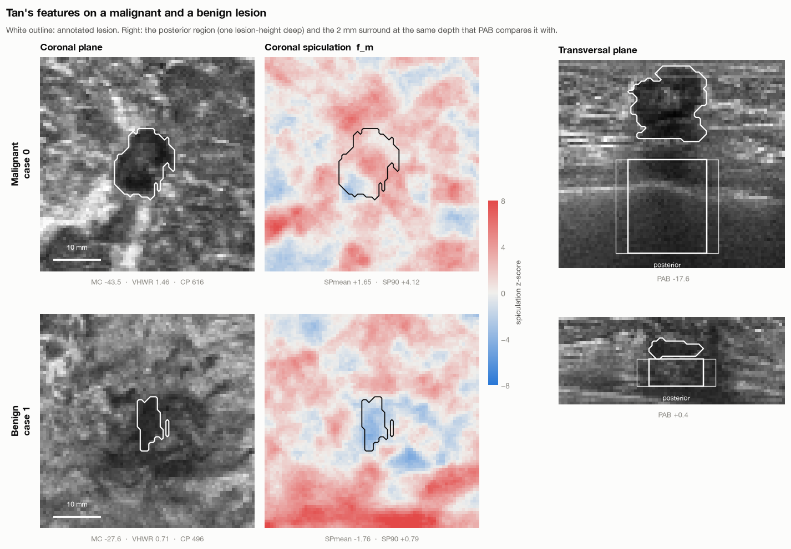
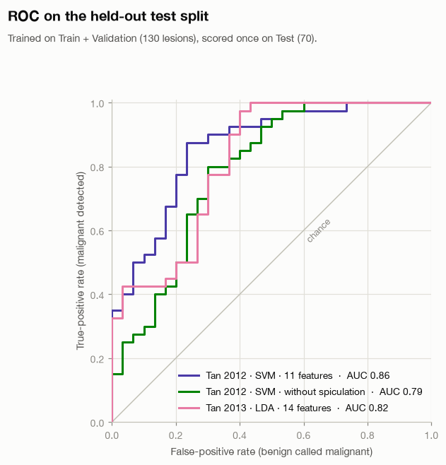

In [Part 1](), I introduced automated 3D breast ultrasound and why its full volumes are useful for studying breast lesions. This post starts where that background ends: implementing published methods, checking their behavior, and comparing their results on a shared dataset.

The work has two outcomes so far. Classical coronal-spiculation features transfer reasonably well to TDSC-ABUS. Our reimplementation of the published Laplace–Beltrami/dual-path CNN system produces useful predictions, but **does not reproduce its reported stacking result**. Both belong in the research record.

This is ongoing work by Ali Naderiparizi and Sepideh Barekatrezaei at the Iran Image Processing Lab, under the supervision of Dr. Ehsan Kozegar and Dr. Mohsen Soryani. The [repository](https://github.com/mralinp/abus-classification) holds the implementations, notebooks and stored result tables. The account below follows local checkout `55859f9`.

# 1. What does “reproduce” mean here?

There are two different exercises in this project:

- **Transfer a published method to another dataset.** We implement Tan and colleagues’ 2012 and 2013 feature-based classifiers on TDSC-ABUS. Their original cohorts, segmentation and validation procedures differ, so matching their exact headline number is not the criterion for success.
- **Reimplement our published hybrid system from its description.** We compare its reported Table 3 with fresh runs and investigate discrepancies. Comparing this implementation with the original author code remains unfinished.

A classifier that produces a plausible AUC is not automatically a faithful implementation. Feature definitions, preprocessing, data splits and the training procedure all need checking.

# 2. Establishing the data and protocol

TDSC-ABUS contains 200 annotated volumes. The official split is:

| Split | Lesions | Malignant | Benign |
| --- | ---: | ---: | ---: |
| Train | 100 | 58 | 42 |
| Validation | 30 | 17 | 13 |
| Test | 70 | 40 | 30 |

Our held-out experiments use Train + Validation for development and training, and report on the 70 official Test lesions. The dataset encodes malignant as `0`; the shared evaluation protocol explicitly converts malignant to the positive class. That conversion matters for sensitivity, probability direction and ROC AUC.

AUC measures ranking across thresholds: roughly, how often a malignant lesion receives a higher score than a benign one. Accuracy measures decisions at a particular threshold. Always predicting malignant already gives 57.1% accuracy on this Test split, so accuracy alone is an inadequate summary.

These experiments use **ground-truth lesion masks**. That isolates classification given a lesion delineation. It does not measure a complete automatic system that must first find and segment the lesion, and it prevents a direct leaderboard comparison with challenge entries doing that harder task. The [challenge paper](https://arxiv.org/abs/2501.15588) describes the broader benchmark.

# 3. Physical dimensions before feature extraction

The image arrays have anisotropic voxels: approximately **0.200 × 0.073 × 0.475674 mm**. Treating one array step as the same physical distance in every direction distorts the lesion and its surrounding tissue.

The Tan implementation uses the documented spacing, identifies axis 1 as ultrasound depth, and resamples the feature-extraction region to 0.6 mm cubic voxels. This is needed because the feature definitions include distances in millimetres: border shells, posterior regions and the neighborhood used to measure spiculation.

It also needs tissue outside the lesion’s bounding box. Cropping tightly around the tumor before computing these features would remove part of the signal we are trying to measure.

# 4. Reproducing the classical features

Tan et al. measure **coronal spiculation**: line-like patterns converging toward a lesion in coronal ABUS planes. Their method estimates local line orientations and asks whether more lines point toward a candidate location than chance would predict. The resulting feature is a quantitative description of that pattern, not a visual judgment supplied to the classifier.

Other features describe intensity, margin contrast, shape and posterior acoustic behavior. The [2012 paper](https://pubmed.ncbi.nlm.nih.gov/22271831/) introduces the coronal-spiculation classifier; our notebook records the implementation choices needed to transfer it to this dataset.

<figure>
  
  <figcaption>Intermediate outputs from the project: inspecting the selected planes, spiculation response and posterior regions helps check what the feature code is measuring.</figcaption>
</figure>

The [Tan notebook](https://github.com/mralinp/abus-classification/blob/55859f9/notebooks/1-tao2013.ipynb) documents differences from the original work. We use expert masks rather than the original automatic segmentation, omit an intensity normalization that needs breast-tissue segmentation, and specify missing detector parameters. A moment-matched ellipsoid approximates the 2013 sphere-registration step. Patient identifiers are unavailable, so lesion-level folds cannot establish patient-independent validation.

For the classical cross-validation experiments, scaling, imputation and SVM tuning happen inside the training folds. Repeated cross-validation over all 200 lesions and evaluation on the official Test split are separate estimates; the former includes lesions from the official Test set in its rotating folds.

# 5. What transferred?

| Method | Official Test AUC | Test accuracy |
| --- | ---: | ---: |
| Tan 2012, 11-feature RBF SVM | 0.86 | 78.6% |
| Same system without spiculation features | 0.79 | 75.7% |
| Tan 2013, 14-feature LDA | 0.82 | 72.9% |

The notebook reports a bootstrap 95% interval of **0.77–0.94** for the 2012 SVM’s Test AUC. That wide interval is part of the result: 70 lesions do not support very precise performance claims.

<figure>
  
  <figcaption>The held-out ROC curves. These are classification results with ground-truth masks, not end-to-end lesion detection results.</figcaption>
</figure>

The most informative finding is not simply 0.86. Individual spiculation features reach AUC 0.80–0.81, and removing them reduces the SVM’s Test AUC by 0.07. The notebook also compares spiculation with lesion volume: the combined predictor performs better in cross-validation than either alone. That supports an association beyond size in this experiment, without proving a biological mechanism.

Other features transfer poorly. Posterior acoustic behavior is near chance here, while height-to-width ratio and margin contrast lose much of their reported discrimination. Differences in cohort composition, intensity processing and segmentation are possible explanations. These experiments do not isolate which explanation is responsible.

# 6. Reimplementing the hybrid model

The next implementation follows our [published hybrid classification paper](https://doi.org/10.1016/j.eswa.2025.129973). It combines an SVM, Extra Trees and a dual-path CNN, using radiomic features, a spectral feature vector and lesion-centered image/mask patches.

The current pipeline generates five-fold out-of-fold predictions on the 130 development lesions. A stacker learns from those predictions; Test predictions from the five base-model folds are averaged. We also evaluate simple probability voting and, in seeds 1 and 2, a logistic-regression stacker.

The [stored CSV files](https://github.com/mralinp/abus-classification/tree/55859f9/results/eswa2025) give the following Test AUCs:

| Model | Published Table 3, as transcribed in notebook | Seed 0 | Seed 1 | Seed 2 |
| --- | ---: | ---: | ---: | ---: |
| SVM | 0.8233 | 0.7667 | 0.7767 | 0.7767 |
| Extra Trees | 0.7771 | 0.8125 | 0.8108 | 0.8088 |
| CNN | 0.7867 | 0.8600 | 0.8283 | 0.8708 |
| Voting | 0.8725 | 0.8625 | 0.8517 | 0.8633 |
| Stacking / current HGB stacker | 0.9350 | 0.7546 | 0.6787 | 0.7383 |
| Current logistic-regression stacker | — | — | 0.8242 | 0.8225 |

“Current HGB stacker” names our implementation; it does not establish that every choice matches the original code. The CNN sometimes exceeds the paper’s corresponding row, voting is fairly close, and stacking falls substantially short. Reporting only the favorable CNN result would misrepresent the reproduction.

The seed runs measure some training variability. They do not represent three independent test cohorts, and their spread is not a confidence interval for generalization.

# 7. Ablations, and the limits of their interpretation

The saved seed-0 ablations vary dimensionality reduction, feature dimensions, feature groups and ensemble members. They do not recover the published preference for the same Isomap configuration or a clear benefit from spectral features in every setting.

There is an important implementation detail in the row named `T7 no LB`: it removes spectral features from the **tabular branches**, while the reused CNN still receives them. It must not be described as removing Laplace–Beltrami features from the whole system. Likewise, `T8 CNN none` removes the CNN’s auxiliary vector while the tabular branches retain theirs.

These are useful comparisons, but the labels alone are insufficient to interpret them. Because many variants have now been scored on the official Test set, choosing the best row afterward would make that set part of model selection. Any final claim needs a fixed protocol and fresh validation.

There is also more protocol cleanup to do: spectral standardization currently fits on all Train + Validation rows before the inner folds. It excludes official Test data, but held-out fold covariates influence preprocessing. Fitting the scaler inside each fold is needed for strictly separated out-of-fold predictions. This post records existing results; it does not silently repair their provenance.

# 8. What we can claim today

We have implemented and exercised classical feature-based methods, stored multi-seed runs of the hybrid reimplementation, and investigated cases where the expected advantage disappears. We have not established an exact reproduction of the original hybrid result, completed the original-code comparison, or clinically validated a diagnostic system.

The unresolved gap is a research question. Candidate causes include feature construction, mesh discretization, preprocessing and training details. The next post follows one of those questions: **does the spectral vector capture lesion shape, lesion size, or properties of the mesh?**

Continue to [Part 3: Laplace–Beltrami, Lesion Shape, and What “Malignancy Signal” Means]().
