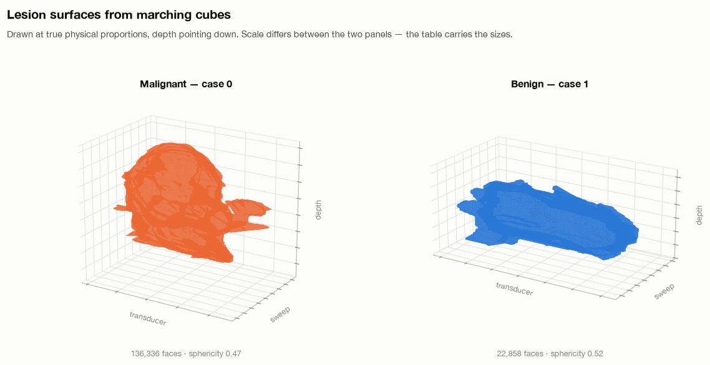

A surface can be described by the patterns of variation it supports. Laplace–Beltrami eigenvalues turn that idea into numbers, making them candidates for describing the geometry of a segmented breast lesion.

The harder question is what those numbers mean when a classifier predicts malignancy. Is it using irregular shape, lesion size, segmentation artifacts, or some combination?

In [Part 2](), I described the reproduction experiments. This post introduces the spectral mathematics, explains what we have implemented and checked, and follows the evidence that made us question our initial interpretation. It records work at checkout `55859f9`, rather than presenting the planned mathematical research as completed.

# 1. Geometry is evidence, not a diagnosis

A malignant lesion is defined by its pathology. An image-derived measurement can be associated with that label without explaining the underlying biology or being sufficient to diagnose a patient.

The classical experiments give a useful example: coronal spiculation features retain discrimination on TDSC-ABUS, but posterior acoustic behavior does not transfer comparably. An imaging feature’s usefulness depends on how the cohort was collected, how the image was acquired and how the feature was measured. The [original spiculation study](https://pubmed.ncbi.nlm.nih.gov/22271831/) supplies the imaging motivation; our experiments test a particular implementation on a different cohort.

A lesion’s surface offers a complementary representation. Instead of keeping every image intensity, we ask what can be learned from the boundary of its expert-provided mask. That boundary is itself an estimate, affected by image resolution and annotation choices.

# 2. From an image mask to a surface

The starting point is a 3D binary array: foreground marks the lesion, background marks everything else. Marching cubes converts its boundary into a triangle mesh. Physical voxel spacing converts array coordinates into millimetres.

<figure>
  
  <figcaption>Reconstructed lesion surfaces at physical proportions, with a different plotting scale in each panel. Two examples illustrate the representation; they do not establish a class-level difference.</figcaption>
</figure>

Meshing was not a neutral preprocessing detail. A tightly cropped mask can touch its array boundary, leaving an open surface. Our `lesion_mesh` helper zero-pads the mask before extraction and translates the vertices back afterward.

The earlier morphological-closing step also damaged thin structures in this dataset. The project records eight open surfaces out of 200 under that path. Disabling that preprocessing and padding the input produced closed surfaces for all 200 in the recorded checks.

Closed does not automatically mean topologically spherical, connected, or free of discretization artifacts. Those conditions need their own checks before applying a theorem that assumes them.

# 3. What is the Laplace–Beltrami operator?

The ordinary Laplacian measures how a function varies relative to its neighborhood. The Laplace–Beltrami operator generalizes that idea to a curved surface, using distances and areas on the surface itself.

With the nonnegative sign convention, its eigenproblem is

$$
-\Delta_S\phi_k = \lambda_k\phi_k.
$$

Here, $S$ is the surface, $\phi_k$ is a pattern over it, and $\lambda_k$ measures the corresponding mode. A vibration or heat-diffusion analogy helps build intuition; these are mathematical modes of the reconstructed surface, not measured vibrations of tissue.

On a connected closed surface, the constant mode has eigenvalue zero. The following eigenvalues summarize progressively finer variations. They provide an intrinsic descriptor: rotating or translating the surface does not change its ideal spectrum. They are not a unique barcode—different geometries can share spectral information, and a finite list loses still more detail.

The [Shape-DNA work](https://reuter.mit.edu/blue/papers/reuter-shapeDNA06/reuter-shapeDNA06.pdf) develops this representation. Its mathematical motivation makes spectral features worth investigating; whether they predict malignancy is a separate empirical question.

# 4. The discrete operator we implemented

On a triangle mesh, our utility builds a cotangent stiffness matrix $L$ and a lumped mass matrix $M$. For an interior edge, the weight is

$$
w_{ij}=\frac{\cot\alpha_{ij}+\cot\beta_{ij}}{2},
$$

where the angles are opposite the edge in its adjacent triangles. The stiffness matrix is $L=D-W$. Each diagonal entry of $M$ contains one third of the total area of the adjacent triangles.

The geometric eigenproblem is then

$$
L\phi_k=\lambda_k M\phi_k.
$$

The mass matrix accounts for the area represented by each vertex. It is not an optional formatting choice: omitting it changes the eigenproblem.

The implementation uses a sparse symmetric solver, with a small negative shift to find low eigenvalues near the singular zero mode. The [source](https://github.com/mralinp/abus-classification/blob/55859f9/abus_classification/features/shape_descriptor/shape_descriptors.py) also implements heat, wave and global-point descriptors. Their presence in the library does not establish validated classification performance.

# 5. A check with a known answer

For the unit sphere, the continuous eigenvalues are $\ell(\ell+1)$, with multiplicity $2\ell+1$:

| Degree | Eigenvalue | Multiplicity |
| --- | ---: | ---: |
| 0 | 0 | 1 |
| 1 | 2 | 3 |
| 2 | 6 | 5 |

The [unit test](https://github.com/mralinp/abus-classification/blob/55859f9/test/utils_tests/features_tests/test_signature.py) constructs a triangulated sphere and checks the first nine values: approximately zero, three values near 2, and five near 6. The nonzero groups have a 5% tolerance.

This checks the sign convention, mass-weighted formulation and low-frequency result against an analytic example. It does not prove convergence on every lesion mesh, robustness to segmentation errors, or a connection to cancer. Each of those needs additional evidence.

# 6. Size is built into the geometric spectrum

If a smooth surface is enlarged by a factor $s$, its geometric eigenvalues scale as

$$
\lambda_k(sS)=s^{-2}\lambda_k(S).
$$

Its area scales as $s^2$. Therefore $\lambda_k A$ is scale-invariant in the ideal geometric formulation; ratios between nonzero eigenvalues also cancel uniform scale.

This matters for interpretation. A raw spectral feature can carry useful information about size. If size is associated with labels in a cohort, a classifier may benefit without learning the size-independent irregularity we hoped to study.

Area normalization changes the question from “what does the raw spectrum predict?” to “what remains when ideal uniform scale is removed?” It does not guarantee that the remaining descriptor is better for classification.

# 7. A crucial distinction in our reproduction

The sphere-tested utility solves the generalized problem above. However, the hybrid reproduction’s [cache builder](https://github.com/mralinp/abus-classification/blob/55859f9/abus_classification/data/lesion_cache.py) currently takes eigenvalues of **$L$ alone**, discarding $M$ to follow its reading of the paper’s equations.

These are different numerical objects. Under uniform scaling of a fixed triangulation, cotangent angles do not change, so $L$ does not change. Its ordinary eigenvalues therefore do **not** obey the geometric $s^{-2}$ law. Across voxel-derived lesions, vertex count, sampling density and geometry vary together, which can still create a strong association with size.

Consequently, multiplying these $L$-only eigenvalues by surface area cannot automatically be interpreted as the theoretically justified normalization of the generalized spectrum. This distinction has to be resolved before attributing a biological meaning to the reproduction features or treating their normalization experiments as a clean test of intrinsic shape.

The sphere test validates the generalized utility. It does not validate the cached $L$-only vector as an equivalent approximation.

# 8. What the exploratory size analysis found

The hybrid notebook records a five-fold development-set logistic-regression comparison on 130 Train + Validation lesions:

| Cached feature transformation | Recorded correlation with lesion volume | Spectral features only, CV AUC | With radiomic features, CV AUC |
| --- | ---: | ---: | ---: |
| Raw log eigenvalues | −0.98 | 0.725 | 0.823 |
| Area-multiplied log values | −0.31 | 0.671 | 0.755 |
| Log ratios to first nonzero eigenvalue | 0.16 | 0.501 | 0.774 |
| Radiomic features only | — | — | 0.761 |

These numbers are recorded in the [notebook discussion](https://github.com/mralinp/abus-classification/blob/55859f9/notebooks/2-barekatrezaei2026.ipynb), rather than a complete saved analysis cell with predictions and fold results. The discussion does not fully specify the correlation summary. They should be treated as exploratory notes pending a reproducible rerun, not as a finished statistical result.

The pattern is nevertheless worth investigating: discrimination falls when transformations reduce the recorded size association. It suggests the current representation may derive substantial predictive information from size or mesh sampling. It does not prove that all spectral information is size, that shape is irrelevant, or that normalization caused the original reproduction gap.

The ablations add another caution. A row called “no LB” only removes spectral features from the tabular branches; the CNN still receives them. It cannot settle the contribution of spectral features to the entire system.

# 9. What would establish a stronger interpretation?

The next experiments need to distinguish three sources of information: **physical size, intrinsic shape, and discretization**.

A defensible sequence is to compare the generalized and $L$-only spectra on the same meshes; vary mesh resolution while holding the surface fixed; scale the same mesh without remeshing; and test controlled shape changes at matched size. On lesions, we then need volume-only, shape-only and combined baselines with all preprocessing fitted inside folds.

Segmentation perturbations and predicted masks are also essential. A descriptor that depends on tiny expert-drawn boundary details may not survive an automatic segmentation pipeline. Repeated inspection of the official Test set during ablation work means final selection needs fresh validation rather than the best observed Test row.

The roadmap also includes spectral geometry results about area, curvature and genus-zero surfaces, and a relationship with spherical harmonics. Those are directions to study and verify under their assumptions. They are not completed malignancy explanations.

# 10. What this work means so far

We have a surface-construction pipeline, a generalized operator with an analytic sphere check, hybrid-model reproduction results, and an exploratory warning that the current spectral features may carry substantial size or sampling information.

That is evidence of progress, including a reason to revise the interpretation. The original goal was to understand what the spectrum contributes. Discovering that a predictive vector may answer a different question is part of that work.

At this stage, “malignancy signal” means an association between a computed measurement and the labels in this dataset. Turning that into a stable shape descriptor, a mechanistic explanation, or a clinically useful tool requires further experiments. The next step is to make those alternatives distinguishable.
